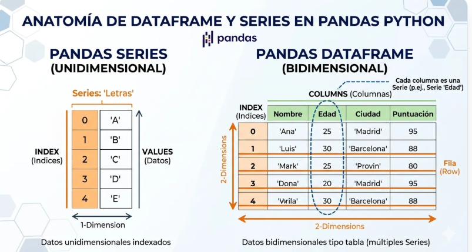
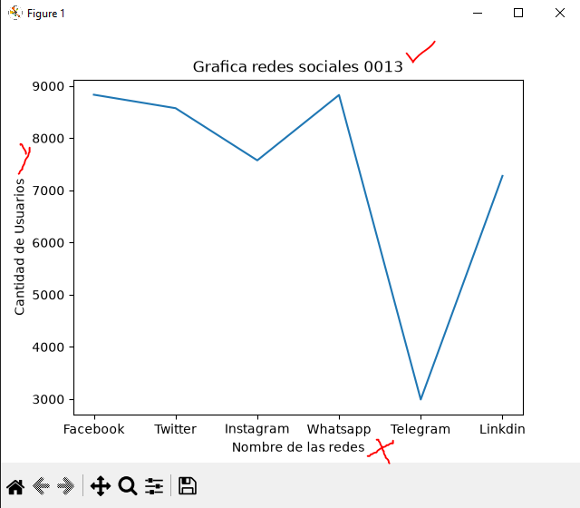
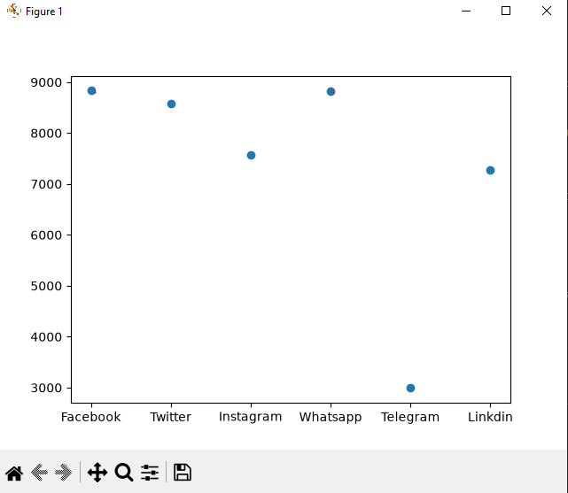
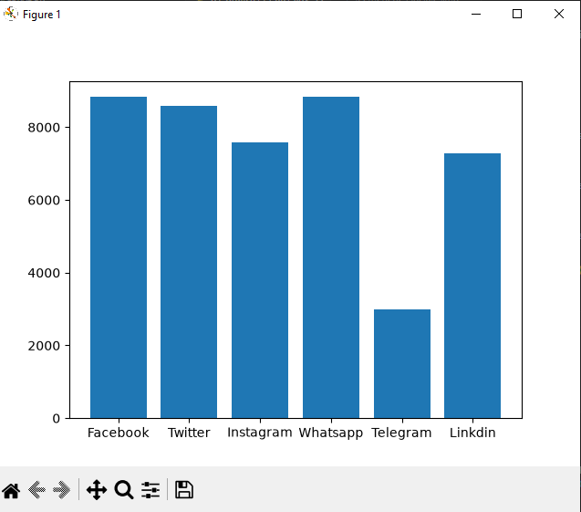
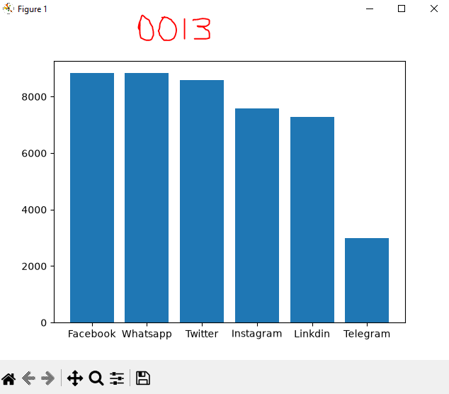
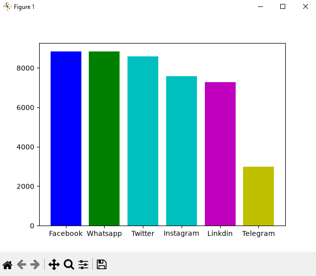
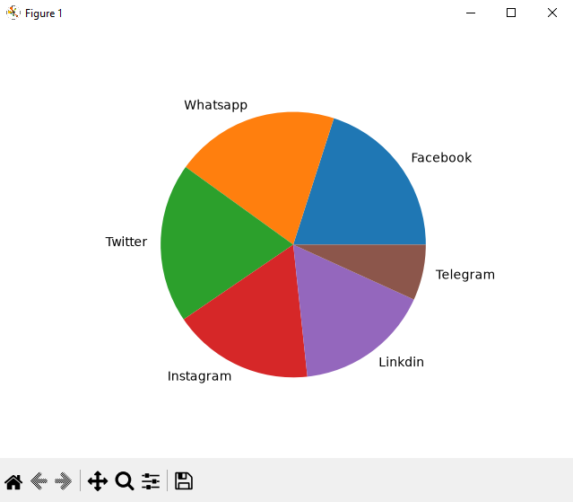

## DataFrame (Marco de datos)

## Redes sociales a nivel mundial

## Grafica lineal de las redes sociales

## Grafica puntos de las redes sociales

## Grafica de barras de las redes sociales 

## Grafica de barras del más grande al más chico de forma descendente

## Colorea la grafica

## Grafica de pastel o pie
